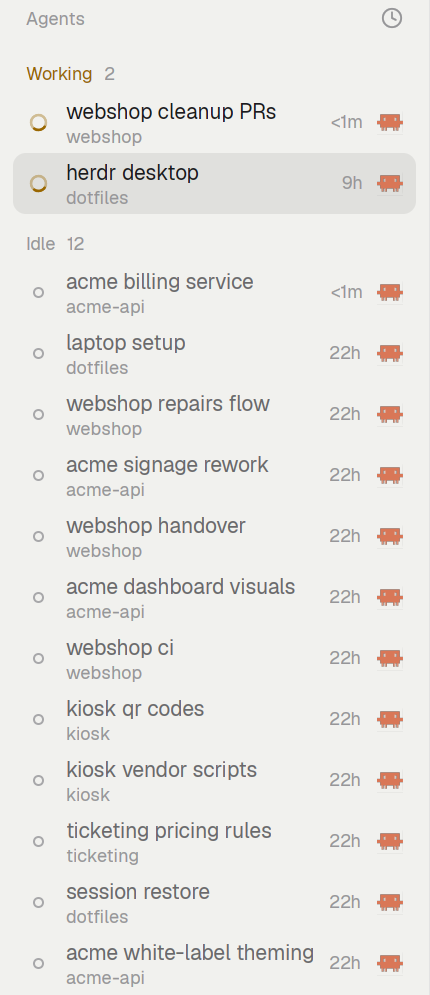
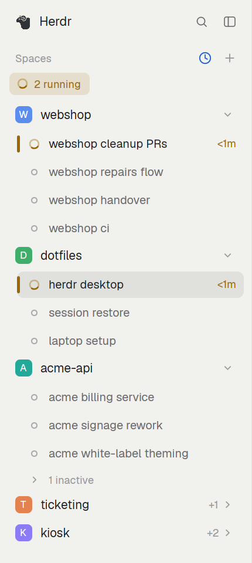

# herdr-desktop-config

Mods, layouts and key bindings for the [Herdr desktop app](https://github.com/herdrdev/herdr-app).

Everything here uses Herdr's mod and layout APIs: they're copies of Herdr's own mods and layouts with different names, so Herdr updates never overwrite them. Tested on Herdr 0.1.13.

## Mods

### my-tabs

The tab bar, with:


- **Automatic tab names.** A tab takes its agent's session name (Claude Code, Codex…) and follows it when it changes. A name you type yourself is never overwritten.
- **Notes.** A Notes button in the panel bar, and a marker on tabs that have a note. Needs `tab-notes`.
- **Claude auto-resume.** After a restart, each tab that was running Claude reruns its original command with `--resume <session>`. It stores the session ID, folder and command as terminal labels, which herdr-core keeps across restarts. A Claude you quit yourself isn't resumed. Each Herdr start writes a log to `~/.config/herdr-app/.claude-resume.log`.
- **Claude transcript search.** The `my-tabs.claude-find` command opens Claude's transcript view and its search.

### my-agents

The agents panel, rearranged: the status icon on the left, the tab name on top, and the space under it in grey.



### my-menu

The right-click menu, plus **Quote selection**: it pastes the selected text into the input as a `> ` markdown quote.

Requires `wl-paste` and `wl-copy` (wl-clipboard), so for now Quote selection only works on Wayland.

### my-sidebar

An experimental sidebar that puts spaces and agents in one panel:



- Agents grouped under their space, and spaces can be collapsed.
- An attention bar counting agents that need you, have finished or are running. Click it to jump to the next one.
- Custom ordering (yours, draggable) or priority ordering (by urgency, then recent activity).
- Agents idle for more than a day are tucked behind an "N inactive" row. A space whose agents are all inactive collapses.

Used by the `sidebar-lab` layout.

### tab-notes

Markdown notes for each tab, from [ozcberkay/herdr-coban](https://github.com/ozcberkay/herdr-coban), unmodified.

## Layouts

- `my-main`: Herdr's default layout, using the mods above.
- `sidebar-lab`: `my-main` with `my-sidebar` in place of the separate spaces and agents lists.

## Keys

`keys.json` binds `ctrl-shift-f` to Herdr's find bar and `ctrl-alt-f` to Claude's transcript search.

## Install

Requires `herdr-app`, plus `jq` to merge the key bindings.

```sh
git clone https://github.com/pierissimo/herdr-desktop-config
cd herdr-desktop-config
./install.sh
```

Then, in Herdr, press **Ctrl+Shift+L** and pick `my-main`, or `sidebar-lab` for the combined sidebar.

## Notes

- **Herdr updates:** each mod's `mod.json` records the upstream version it was copied from (`cloned_from`). After an update, diff upstream `defaults/mods/<name>` between the two tags and port the fixes into these copies.
- **Updating this repo:** copy `~/.config/herdr-app/mods/my-*`, `mods/tab-notes` and `layouts/{my-main,sidebar-lab}.json` back into the repo, leaving out `gpui-kit.d.ts` and `jsconfig.json`.

## License

Apache-2.0, the same license as Herdr and herdr-coban. See `NOTICE`.
