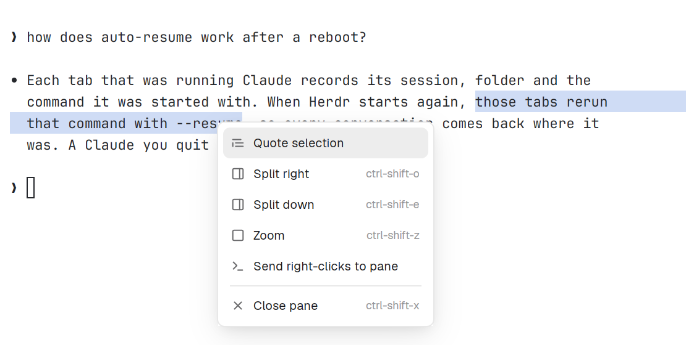
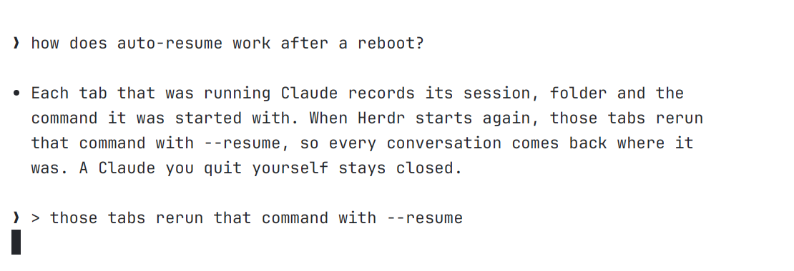

# herdr-desktop-config

A layout and a few mods for the [Herdr desktop app](https://github.com/herdrdev/herdr-app), built for running many coding agents at once.

They're renamed copies of Herdr's own files, so Herdr updates never overwrite them. Tested on Herdr 0.1.13.

## Install

Paste this into a coding agent (Claude Code, Codex…) on the machine running Herdr:

```text
Read ~/.config/herdr-app/AGENTS.md, then install mods from
https://github.com/pierissimo/herdr-desktop-config into my Herdr.
Ask me which ones I want, merge keys.json without overwriting my bindings,
and adapt anything platform-specific to this machine.
```

Prefer doing it by hand? Run `./install.sh` from a clone. It needs `jq`.

## Sidebar

`my-sidebar` puts spaces and agents in one panel.

- Agents are grouped under their space, and spaces collapse.
- An attention bar counts agents that need you, have finished or are running. Click it to jump to the next one.
- **Custom** mode keeps your order, which you set by dragging. **Priority** mode sorts by urgency, then by recent activity. Switch modes from the icon in the header.
- Agents idle for more than a day fold into an "N inactive" row.


## Tabs


`my-tabs` is the tab bar, with:

- **Auto names.** Tabs follow the agent's session name. A name you type is kept.
- **Notes.** Per-tab markdown notes, from [tab-notes](https://github.com/ozcberkay/herdr-coban). Tabs with a note get a marker.
- **Claude auto-resume.** After a restart, Claude sessions come back with the command they were started with. Each start writes a log to `~/.config/herdr-app/.claude-resume.log`.

## Right-click menu

`my-menu` adds **Quote selection**, which pastes the selected text into the input as a `> ` quote. It needs `wl-clipboard`.





## Keys

| Key | Action |
|---|---|
| `ctrl-shift-f` | Herdr's find bar |
| `ctrl-alt-f` | Claude's transcript search |

## Updating

Each `mod.json` records the Herdr version it was copied from (`cloned_from`). After a Herdr update, port upstream fixes from `defaults/mods/<name>`.

To publish local changes, copy the mods and `layouts/sidebar-lab.json` from `~/.config/herdr-app` back into this repo, leaving out `gpui-kit.d.ts` and `jsconfig.json`.

## License

Apache-2.0, like Herdr and herdr-coban. See [NOTICE](NOTICE).
